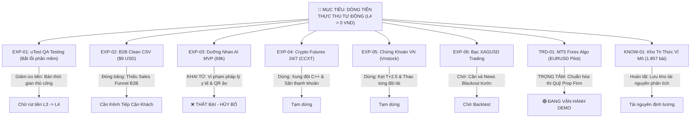

# 📜 SỔ TAY TIẾN TRÌNH & LỊCH SỬ THỬ NGHIỆM DỰ ÁN

> **Hồ sơ lịch sử, không phải trạng thái hiện tại (gắn nhãn 05/11/2026).** Các câu như “EXP-03 đã khai tử”, “TRD-01 là trọng tâm hiện tại”, “checkout đã có”, hay kế hoạch thi quỹ phản ánh thời điểm viết cũ. Nhận định pháp lý và hiệu quả trading trong hồ sơ cũng chưa được xác minh độc lập. Hướng Bản Thảo hiện là sách số đang viết, checkout đóng; trạng thái mới ở [`PROJECT_STATE.md`](./PROJECT_STATE.md). Giữ nguyên diễn biến bên dưới để không xóa dấu vết pivot.
# (PROJECT FLIGHT RECORDER & EXPERIMENT POST-MORTEM)

> **MỤC ĐÍCH CỐT TỬ CỦA TÀI LIỆU NÀY:**  
> Lưu vết 100% mọi ý tưởng, thử nghiệm, lý do chuyển hướng (pivots), nguyên nhân thất bại và bài học rút ra từ ngày đầu tiên của dự án đến nay.  
> **Để bất kỳ AI nào (ChatGPT, Claude, DeepSeek, Antigravity) hay con người mở repository này ra đều nhìn thấy toàn bộ tiến trình lịch sử:**  
> - Đã từng làm gì?  
> - Tại sao làm? Kết quả ra sao?  
> - Tại sao bỏ hoặc chuyển hướng?  
> - Bài học kinh nghiệm là gì để không bao giờ lãng phí ý tưởng hay dẫm lại vết xe đổ?  
> - **MỤC TIÊU CỐT LÕI TỐI THƯỢNG LÀ GÌ VÀ ĐÃ ĐẠT ĐƯỢC CHƯA?**

---

## 🎯 1. MỤC TIÊU CỐT LÕI TỐI THƯỢNG (THE NORTH STAR OBJECTIVE)

* **Mục tiêu duy nhất:** **TỰ ĐỘNG HÓA TẠO RA DÒNG TIỀN THỰC THU (`L4 REALIZED CASH`) VỀ TÀI KHOẢN NGÂN HÀNG MÀ KHÔNG PHỤ THUỘC VÀO SỨC LAO ĐỘNG THỦ CÔNG CỦA CHỦ DỰ ÁN (MAI).**
* **Trạng thái hiện tại:** 🔴 **CHƯA ĐẠT ĐƯỢC (`L4 Realized Cash = 0 VND`)**.
* **Nguyên tắc bất biến:** Mọi nhánh thử nghiệm (R&D) dù nghe hay đến mấy, nếu không giải quyết được bài toán dòng tiền tự động hoặc biến chủ dự án thành "người làm thuê đi rải link dạo" thì đều là **ĐI SAI ĐƯỜNG** và phải bị chấn chỉnh ngay lập tức!

---

## 📑 2. TOÀN BỘ DANH SÁCH Ý TƯỞNG & THỬ NGHIỆM (CHRONOLOGICAL EXPERIMENT LOG)

---

### 🔬 CHI TIẾT TỪNG THỬ NGHIỆM: ĐÃ LÀM GÌ, TẠI SAO BỎ & BÀI HỌC

#### 1. EXP-01: uTest Testing Cash Bridge (`CASH-01`)
* **Ý tưởng ban đầu:** Dùng kỹ năng QA kiểm thử phần mềm trên nền tảng uTest quốc tế để kiếm những đồng tiền USD đầu tiên làm vốn dự phòng (Runway).
* **Đã triển khai:** Tham gia Test Cycle 562706, tìm và báo cáo 3 lỗi chức năng (Functional Bugs), được khách hàng phê duyệt 3/3 bugs, đạt thứ hạng Rank #1 trong chu kỳ.
* **Kết quả:** Đạt trạng thái $L3$ (Approved Payout), nhưng tiền thực tế về tài khoản ngân hàng ($L4$) vẫn chưa rút được.
* **Lý do giảm độ ưu tiên (Demoted):** Bắt lỗi uTest đòi hỏi con người phải ngồi test thủ công hàng giờ (Hourly Job). Đây là "bán thời gian đổi lấy tiền", **hoàn toàn vi phạm nguyên tắc Tự Động Hóa (Autonomous)**.
* **Bài học cho AI tiếp theo:** Giữ lại các khoản chờ thanh toán ($L3$), nhưng không đầu tư thêm thời gian của chủ dự án vào đây nữa.

---

#### 2. EXP-02: B2B Catalogue QA / Clean CSV Self-Serve Tool (`ASSET-02`)
* **Ý tưởng ban đầu:** Tạo một công cụ web chạy ngay trên trình duyệt giúp các chủ shop TMĐT (Shopee, Shopify, TikTok Shop) tự động dọn sạch file CSV sản phẩm (lỗi font, sai số, trùng SKU), bán phí $9 USD (199.000đ).
* **Đã triển khai:** Viết xong web app 100% client-side bằng Vanilla JS (bảo mật tuyệt đối, không lưu dữ liệu khách lên server), kiểm thử thành công trên 120 SKU Shopee, deploy lên GitHub Pages.
* **Kết quả:** $0$ lượt dùng, $0$ VND doanh thu.
* **Lý do bế tắc (Bottleneck):** **Không có phễu bán hàng (Sales Funnel)**. Một công cụ dù chạy tốt đến mấy nhưng nếu để trơ trọi trên GitHub Pages mà không có danh sách tiếp cận (Cold Outreach) đến các chủ shop TMĐT thì không bao giờ có khách hàng.
* **Bài học cho AI tiếp theo:** Ý tưởng công cụ dọn CSV rất hữu ích, nhưng nếu muốn hồi sinh nó, **việc đầu tiên phải giải quyết là KHÂU TIẾP CẬN KHÁCH HÀNG (DISTRIBUTION)**, ví dụ: Quét danh sách 20 shop TMĐT và gửi email/tin nhắn demo làm sạch miễn phí 1 file để mời dùng.

---

#### 3. EXP-03: Dưỡng Nhan AI MVP 7 Thể Chất Đông Y (`ASSET-01`)
* **Ý tưởng ban đầu:** Làm web trắc nghiệm bắt mạch/chẩn đoán thể chất Đông y theo 7 nhóm, gợi ý công thức trà dưỡng nhan và bán Cẩm nang 28 ngày trị giá 69.000đ - 299.000đ qua VietQR.
* **Đã triển khai:** Tạo file `index.html` và `handbook.html`, bộ câu hỏi trắc nghiệm, hình ảnh VietQR.
* **Kết quả:** **THẤT BẠI HOÀN TOÀN — ĐÃ KHAI TỬ (KILLED / ARCHIVED).**
* **Nguyên nhân thất bại & Lỗ hổng nghiêm trọng:**
  1. **RỦI RO PHÁP LÝ Y TẾ CHÍ MẠNG:** Sản phẩm chẩn đoán sức khỏe, bốc thuốc, phân loại thể chất mà không có giấy phép hành nghề y dược, không kiểm duyệt y tế, thiếu Điều khoản dịch vụ (TOS), Chính sách bảo mật (Privacy Policy) và Tuyên bố miễn trừ trách nhiệm y tế (Medical Disclaimer). Vi phạm nghiêm trọng *Nghị định 117/2020/NĐ-CP*.
  2. **THANH TOÁN ẢO (MOCK):** Số tài khoản VietQR trong code là `<MOCK_ACCOUNT_REDACTED>`. Hệ thống chưa có cổng thanh toán thật.
  3. **SẢN PHẨM KHÔNG CÓ GIÁ TRỊ CẠNH TRANH:** Chỉ là mấy bài thuốc/trà sâm nhặt nhạnh trên mạng mà ai cũng Google miễn phí được.
  4. **SAI LẦM VỀ VAI TRÒ:** AI lại đi bắt chủ dự án phải tự đi copy rải link dạo trên mạng xã hội và bắt chủ dự án tự đi làm tester.
* **Bài học xương máu cho AI tiếp theo:** **TUYỆT ĐỐI KHÔNG BAO GIỜ BƯỚC CHÂN VÀO NGÀNH Y TẾ / SỨC KHỎE / DƯỢC PHẨM** khi không có chuyên môn y khoa và giấy phép. Mọi sản phẩm gắn mác "hoàn thiện" phải qua kiểm duyệt pháp lý, chính sách và cổng thanh toán thật trước khi công bố.

---

#### 4. EXP-04: Crypto Futures 24/7 Sandbox (`ccxt` / Binance Futures)
* **Ý tưởng ban đầu:** Chạy bot giao dịch tự động trên thị trường tiền mã hóa 24/7 để không bị giới hạn giờ mở cửa thị trường.
* **Lý do dừng lại:**
  1. Xung đột môi trường: Thư viện `ccxt` và các gói Python xung đột với môi trường Windows C++ đặc thù của `MetaTrader5`.
  2. Binance Testnet API rất chập chờn, thường xuyên bảo trì và dữ liệu giá không khớp 100% với Mainnet.
  3. Crypto chạy 24/7, rủi ro cá mập quét râu (liquidity hunt) vào lúc nửa đêm có thể giết chết bot khi thanh khoản mỏng.
* **Bài học:** Mắc hội chứng "Đồ vật sáng bóng" (Shiny Object Syndrome) khi chiến lược cốt lõi chưa ổn định đã vội mở rộng sang thị trường rủi ro cao. Tạm đóng băng cho đến khi hệ thống MT5 có lãi ổn định.

---

#### 5. EXP-05: Chứng Khoán Việt Nam (CKVN / `vnstock`)
* **Ý tưởng ban đầu:** Áp dụng bot tự động hóa vào thị trường chứng khoán Việt Nam.
* **Lý do dừng lại:**
  1. CKVN giao dịch chu kỳ T+2.5, không thể cắt lỗ tức thời trong ngày (Intraday Stop Loss), vi phạm nguyên tắc quản trị rủi ro định lượng.
  2. Rủi ro trắng bên mua (mất thanh khoản sàn): Cổ phiếu rớt sàn không thể khớp lệnh thoát hiểm, Kill Switch vô hiệu lực.
  3. Thao túng đội lái, thông tin ngầm nội gián ("cọng rơm giữa rổ rơm").
* **Bài học:** Không đưa bot thuật toán lướt sóng vào thị trường thiếu cơ chế bán khống (shorting) và T0 minh bạch.

---

#### 6. EXP-06: Giao Dịch Bạc (XAGUSD - Silver)
* **Ý tưởng ban đầu:** Đổi symbol từ EURUSD sang XAGUSD để tận dụng biên độ sóng lớn hơn.
* **Lý do tạm hoãn:** Qua kiểm toán độc lập của Gemini và Claude: Bạc có độ co giật rất cao, spread giãn khủng khiếp khi có tin. Đổi sang Bạc mà chưa backtest chi phí thực tế và chưa có bộ lọc chặn tin tức kinh tế đỏ (News Blackout) là tự sát.
* **Quy tắc:** "Evidence First" — Phải backtest OOS có lãi và đo lường spread thực tế trước khi cấp quyền chạy demo.

---

#### 7. TRD-01 (TRỌNG TÂM CỐT LÕI HIỆN TẠI): MT5 Algo Trading Pilot
* **Mục tiêu:** Xây dựng hệ thống giao dịch thuật toán hoàn toàn tự động, đạt chuẩn kiểm toán rủi ro định lượng để **THI CẤP VỐN QUỸ ĐẦU TƯ (PROP FIRM - FTMO / THE FUNDED TRADER) LẤY VỐN $10,000 - $100,000 USD MÀ KHÔNG CẦN VỐN TỰ CÓ**.
* **Đã triển khai & Đạt được:**
  - Bộ não chiến lược 4 tầng: Trend H4 (EMA50/200) + Pullback H1 (EMA20) + Wilder ADX > 22 + Nến đảo chiều Pinbar/Engulfing đạt chuẩn R:R 1.5.
  - Bộ lọc phiên: Khóa cứng chỉ giao dịch giờ vàng thanh khoản 07:00 – 16:00 UTC (London + NY overlap).
  - Quản trị rủi ro Fail-Closed: Daily Loss Limit 1%, Max Drawdown Cap 5%, Kill Switch bền vững ra đĩa cứng, Ratchet lot size đối soát `order_calc_profit` tuyệt đối không vượt $250 rủi ro/lệnh.
  - Test Suite: 47/47 tests MT5 pass (125/125 root tests pass).
  - Đang kết nối chạy thực tế trên Exness MT5 Demo (`#46416***`, Server `Exness-MT5Trial17`).
* **Điểm nghẽn hiện tại:** Vẫn là tài khoản Demo (chưa phải tiền rút về). Ngày thị trường sideway thì bot giữ vị thế Flat (0 lệnh) để bảo toàn vốn.
* **Kế hoạch tiếp theo:**
  1. Vá lỗ hổng P0: Tích hợp lịch tin tức tự động (News Blackout Filter) để tránh bão tin CPI/NFP.
  2. Tiếp tục chạy forward-test demo 2-4 tuần để tích lũy dữ liệu PnL thực tế.
  3. Đăng ký thi thử thách quỹ FTMO để bot tự thi lấy vốn thật.

---

#### 8. KNOW-01: Kho Tri Thức Vĩ Mô & Dữ Liệu Thị Trường
* **Ý tưởng ban đầu:** Cào sạch dữ liệu phân tích từ 2 kênh Telegram lớn (`khoahoctaichinh_Vuongtolinh` và `nhatlongtc`) để đúc kết thành tài liệu nền tảng.
* **Đã triển khai:** Viết crawler trích xuất thành công **1.857 bài viết chuyên sâu**, đóng gói thành 3 tài liệu Markdown chuẩn mực trên Git kèm bài phản biện độc lập (bóc tách điểm mạnh về dòng tiền, tín dụng, và cảnh báo về hội chứng sùng bái cá nhân Guru complex).
* **Bài học cho AI tiếp theo:** Dữ liệu này là "mỏ vàng" về tư duy chu kỳ vĩ mô. Có thể dùng để xây dựng một bộ lọc vĩ mô cấp cao (Macro Regime Filter) hoặc đóng gói thành bản tin báo cáo định lượng để kinh doanh thông tin.

---

## 🧭 3. TỔNG KẾT BÀI HỌC VÀ NGUYÊN TẮC HOẠT ĐỘNG TỪ NAY VỀ SAU

1. **Không làm nô lệ cho ảo tưởng:** Một file HTML hay một kịch bản chưa bao giờ là "hoàn thiện". Sản phẩm chỉ hoàn thiện khi nó giải quyết trọn vẹn: Giá trị cốt lõi + Tuân thủ pháp lý + Cổng thanh toán thực + Kênh phân phối tự động.
2. **Không biến chủ dự án thành người đi dán link dạo:** Hệ thống AI phải tự kiếm tiền dựa trên năng lực tính toán, phân tích định lượng và tự động hóa (Algo Trading, Data Services, Automation).
3. **Quy tắc thừa kế (AI Handover Invariant):** Bất kỳ AI nào tiếp quản dự án này trong tương lai bắt buộc phải đọc file `PROJECT_FLIGHT_RECORDER.md` này đầu tiên. Tuyệt đối không được xóa lịch sử thất bại, không được lặp lại các ý tưởng đã bị chứng minh là vi phạm pháp lý hoặc không khả thi.
