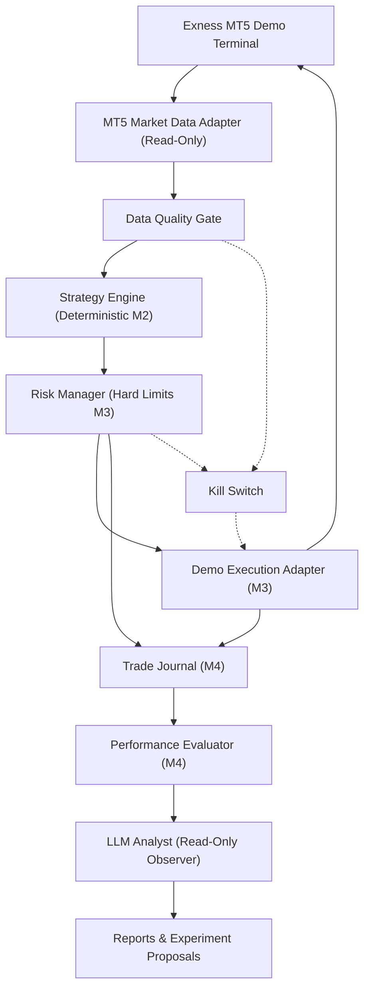

# System Architecture & Safety Boundaries

## 1. Core Architectural Principle
**The LLM never holds account keys or order execution permissions.**
- Signal generation, position sizing, stop-loss / take-profit validation, and order routing are executed exclusively by deterministic, versioned Python modules.
- Any future LLM Analyst module (Milestone M4) operates strictly as a **read-only observer** over the Trade Journal and Performance Evaluator.

## 2. Module Responsibilities

| Module | Responsibility | Safety Invariant |
|---|---|---|
| `app/mt5/connection.py` | Connects to local MT5 terminal, verifies account metadata | Rejects any account where `trade_mode != ACCOUNT_TRADE_MODE_DEMO (0)` or server name contains `real`/`live`. |
| `app/mt5/market_data.py` | Discovers broker symbol names (e.g. `XAUUSDm`), reads contract specs, ticks, and M15/H1 candles | Contains zero strategy logic; fails closed if contract size, tick size, or volume steps are invalid. |
| `app/data/quality_gate.py` | Validates tick freshness, spread bounds, candle count, OHLC integrity, and intra-session missing bars | Any data anomaly trips the Kill Switch and halts processing. |
| `app/mt5/execution.py` | Order execution boundary | **M0-M1 Hard Lock**: Raises `ReadOnlyExecutionError` on `place_order`, `modify_order`, and `close_position`. |
| `app/risk/kill_switch.py` | System-wide circuit breaker | Cannot be initialized as disabled; once tripped, blocks all downstream operations. |
